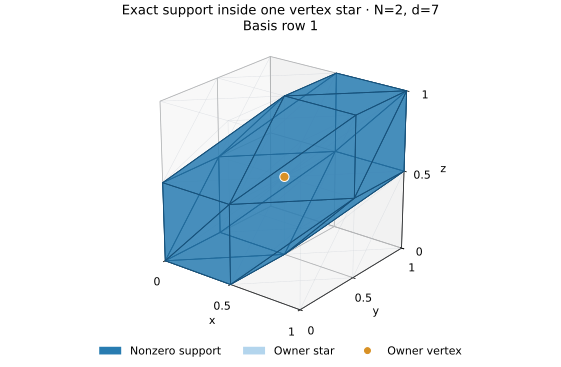
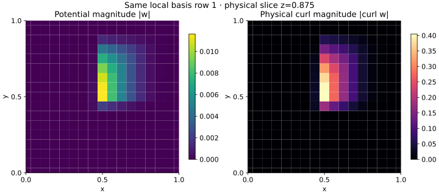
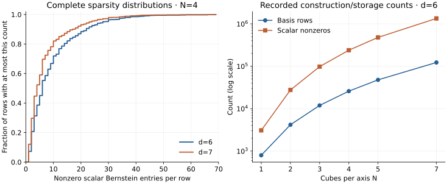

# Freudenthal Potentials

**Local polynomial potentials with continuous curl, constructed as sparse integer bases.**

Freudenthal Potentials is a Python finite-element research tool for the
consistently oriented six-tetrahedron subdivision of a cube grid. It constructs
continuous vector polynomial potentials whose curls are also continuous.
Default construction checks each basis function's recorded owner vertex star.
Use it to inspect local spaces, assemble curl constraints, evaluate basis
functions or build reproducible finite-element experiments.

**AI-created software.** The implementation, API, tests, benchmarks and
documentation were produced by AI agents under Kaiwen Jin's direction.
This does not imply independent human review or mathematical certification.
See [the provenance and credit statement](NOTICE.md).

[](https://github.com/yuiyuiui/freudenthal-potentials/actions/workflows/ci.yml)
[](LICENSE)

## Install and try

Python **3.11+**, NumPy and SciPy are required. Install the fixed GitHub release:

```bash
python -m pip install "git+https://github.com/yuiyuiui/freudenthal-potentials.git@v0.2.0"
```

```python
import numpy as np
from freudenthal import construct_basis, dimension

basis = construct_basis(N=2, degree=7)  # 8 cubes, 48 tetrahedra
assert len(basis) == dimension(2, 7) == 6792
assert basis.verify()["all_curl_components_residual_nnz"] == 0

potential, curl = basis.evaluate(1, [0.5, 0.5, 0.875])
points = np.array([[0.5, 0.5, 0.875], [0.1, 0.1, 0.9]])
potentials, curls = basis.evaluate_many(1, points)  # each shape (2, 3)
active_tets = basis.support_tetrahedra(1)
owner = basis.space.mesh.vertices[basis.owners[1]] / basis.space.mesh.N
print(basis.summary())
```

`degree` is the **potential degree** `d = k+1`, with `d >= 6` and `N >= 1`.
Evaluation takes physical coordinates in `[0,1]^3` and returns physical curl,
including the mesh-scale factor `N`. Coefficients are Bernstein coefficients,
not point values. Gradients remain in the space, and no boundary condition is
imposed. See the [worked example](examples/quickstart.py), [API](docs/api.md)
and [mathematical conventions](docs/method.md).

## Defaults and explicit configurations

`construct_basis(N, degree)` needs only the **problem inputs**. It never changes
the mesh or potential degree. Its shared policy selects stored degree-six bases
for `N<=4`, window transfer for larger degree-six grids, checked one-cube
reconstruction for `N=1,d>6`, and parametric rules for `N>=2,d>=7`.
Full finite verification is on. Independence uses the exact free-coordinate
identity when available, and modular rank otherwise.

Inspect the plan before any mesh/matrix allocation, or request an explicit
reference configuration:

```python
from freudenthal import construct_basis, plan_construction

plan = plan_construction(2, 7)
print(plan.to_dict())  # chosen method, exact counts and selection reasons
reference = construct_basis(
    2, 7, method="parametric", independence="modular",
    rank_prime=1000033, max_variables=10125,
)
print(reference.configuration)  # construction policy and actual last check
```

| Need | Recommendation and consequence |
|---|---|
| Ordinary use | Keep `verify=True` and `method="auto"`; no method tuning required |
| Independent modular cross-check | Set `independence="modular", rank_prime=1000033`; adds work, not floating-point accuracy |
| Reproducible branch | Pin the method shown by `plan_construction`; incompatible choices fail |
| Admission guard | Set positive `max_variables`; checks `3*(N*d+1)^3` before allocation, **not peak RAM** |
| Deferred checks | Advanced users may set `verify=False`, then call `basis.verify()`; the unchecked result is explicitly marked deferred |

The default prime `1000003` preserves the previous implementation. Only that
prime and `1000033` are supported; failures never silently switch prime,
precision, backend or problem. `max_variables=None` preserves the previous
input domain without pretending to know available RAM. Construction uses
signed integer arithmetic; evaluation stays binary64. Complete types, ranges,
costs, recommendations and failure behavior are in the [parameter contract](docs/parameters.md).

The installed CLI calls the **same resolver**:

```bash
python -m freudenthal 2 7 --plan
python -m freudenthal 2 7 --independence modular --rank-prime 1000033 --max-variables 10125
```

Matched [benchmarks](bench/README.md) compare the default, pinned settings,
an alternate-prime reference, and construction followed by deferred verification
on the same inputs. All finish full checks; unchecked construction time is
never presented as an equally validated speedup. See the [selected results](bench/results/policy_v0.2.0.json),
[test suite](test/) and [reproduction commands](docs/development.md).

## What locality looks like



For the computed `N=2, d=7` example, blue tetrahedra are the **exact nonzero
polynomial support** of the selected basis function. The lighter star is its
recorded owner patch; grey edges show the surrounding mesh. The orange owner
marker is drawn in front of the transparent surface for visibility. Support is derived
from coefficients, not inferred from sampled values.



The same basis function is evaluated on a horizontal physical slice. The two
panels show Euclidean magnitudes of the potential and its curl, with separate
colour scales. These are direct floating-point evaluations of the constructed
polynomials, not a PDE solution or a normalized stability experiment.

## Sparse structure



The left panel uses **every bin** of the `N=4` row-length histograms at
degrees six and seven. An entry means one scalar component of a vector
Bernstein coefficient. The right panel shows actual dimension and sparse
nonzero counts for the recorded degree-six grids. These diagnostics describe
storage structure; they do not establish a speed advantage or a uniform
decomposition norm. The fixed summaries are publicly sourced and hashed in
[`numerical_case/reference/PROVENANCE.json`](numerical_case/reference/PROVENANCE.json).

Reproduce the new geometry example and all three plots with explicit inputs
and **fresh** output directories:

```bash
git clone --branch v0.2.0 https://github.com/yuiyuiui/freudenthal-potentials.git
cd freudenthal-potentials
python -m pip install ".[plot]"
OMP_NUM_THREADS=1 OPENBLAS_NUM_THREADS=1 VECLIB_MAXIMUM_THREADS=1 \
  python numerical_case/run_example.py --output numerical_case/results/example-1
python numerical_case/plot_results.py \
  --input numerical_case/results/example-1 \
  --reference numerical_case/reference \
  --output numerical_case/results/figures-1
```

The scripts refuse existing output directories and preserve each run's
manifest. They never overwrite the distributed reference summaries or README
figures. See [the experiment guide](numerical_case/README.md).
The distributed geometry figures retain their original v0.1.0 provenance;
the mathematical construction is unchanged in v0.2.0.

## Scope and reliability

- Basis construction supports the stated cube meshes and integer `N >= 1`,
  `d >= 6`, subject to memory limits. General meshes and boundary-constrained
  spaces are not implemented.
- Construction and membership checks use integers, safe accumulation bounds
  and exact modular rank tests. `construct_basis` verifies by default.
- For `N=1, d>6`, both construction and `dimension` perform a checked integer
  kernel reconstruction; this can be expensive or fail explicitly.
- Direct Bernstein evaluation uses binary64. Stable evaluation at arbitrarily
  high degrees and well-conditioned bases are not guaranteed.
- Finite tests validate concrete instances. The associated all-parameter
  computer-assisted mathematical claim also needs the manuscript's analytical
  coverage arguments. Software CI is not mathematical certification.

The [manuscript](https://github.com/yuiyuiui/AIM/blob/f69a9853cae1afc0f82ee4f466c5a53b30709f9a/research/solutions/633-kaiwen-jin-freudenthal-potentials/paper/main.pdf)
contains the full mathematical argument. Its submission and independent
review are separate from this software release. Fixed proof-critical
certificate inputs and [checking programs](src/freudenthal/CERTIFICATES.md)
are distributed with the package; replay requires SymPy and a C++17 compiler.

## Develop, test and cite

```bash
python3.13 -m venv .venv
.venv/bin/python -m pip install -r requirements-lock.txt
.venv/bin/python -m pip install ".[validation]"
OMP_NUM_THREADS=1 OPENBLAS_NUM_THREADS=1 VECLIB_MAXIMUM_THREADS=1 \
  .venv/bin/python -m pytest test
  .venv/bin/python -m ruff check src/freudenthal test examples bench numerical_case/*.py verify_all.py
.venv/bin/python -m build
```

The locked numerical/plotting environment uses Python 3.13. On Python 3.11,
install `.[validation]` without that lock to resolve compatible dependencies.
CI checks installed wheels on Linux (Python 3.11 and 3.13) and macOS (Python
3.13), plus certificate replay on Linux. See [development instructions](docs/development.md).

**Kaiwen Jin · [yui.ui.siki@gmail.com](mailto:yui.ui.siki@gmail.com)**.
MIT licensed. Cite the version using [CITATION.cff](CITATION.cff), and cite
the manuscript when using the mathematical construction. [NOTICE.md](NOTICE.md)
records the source lineage and ChatGPT/Codex assistance.

## Core optimization evidence

See the [paired time and memory benchmark](bench/README.md) for profiles,
independent checks, limitations and reproduction commands, and
[release readiness](docs/RELEASE_READINESS.md) for installed-package evidence.
